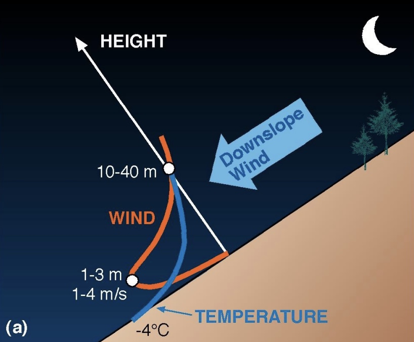

| **Author** | **Project** | **License** | 
|:----------:|:-----------:|:-----------:|
| **Chiara Bindandi** | **SLOPE-model** |  |

# SLOPE-model
**SLOPE** (**S**lope flow **L**imits of **P**randtl's **E**quilibrium) model è un modello per lo studio dei flussi lungo i pendii (upslope, downslope) basato sulla teoria dei venti di pendio di L. Prandtl. 
Si considera una slope inclinata di un angolo α rispetto all’orizzonte e si suppone che al di sopra sia presente una massa d’aria stabile (la temperatura potenziale dell'aria aumenta con l'aumentare dell'altitudine). 
Le coordinate del sistema di riferimento classico vengono sostituite con coordinate più appropriate allo studio, la coordinata s parallela alla pendenza e la coordinata n normale al pendio.

  
  
   
  <em>Profili di vento downslope e upslope nel sistema di riferimento del pendio. La coordinata n perpendicolare alla slope (HEIGHT) e la coordinata s, non rappresentata, parallela.</em>

## Bibliografia

1. Whiteman, C. D. & Dreiseitl, E. (June 1, 1984). *Alpine meteorology: translations of classic contributions by A. Wagner, E. Ekhart, and F. Defant*. ASCOT-84-3. (https://digital.library.unt.edu/ark:/67531/metadc1181432/)
