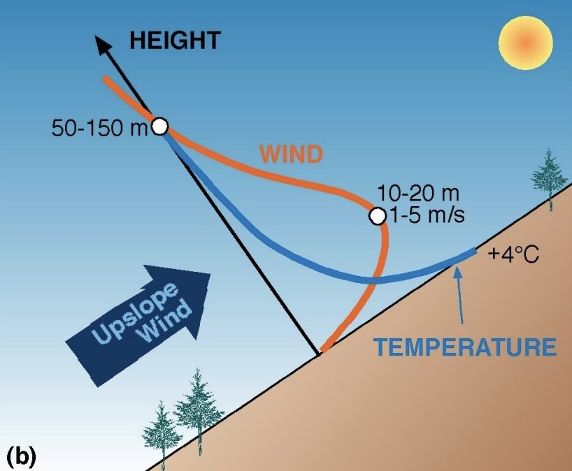

<div align="center">

| **Author** | **Project** | **Code Quality** | **License** | 
|:----------:|:-----------:|:-----------:|:-----------:|
| **Chiara Bindandi** | **SLOPE-model** |  | [](https://gnu.org) |

<br/>


</div>

<!-- start-docs -->

# SLOPE-model
**SLOPE** (**S**lope flow **L**imits of **P**randtl's **E**quilibrium) model è un modello per lo studio dei flussi lungo i pendii (upslope, downslope) basato sulla teoria dei venti di pendio di L. Prandtl. 
Si considera una slope inclinata di un angolo α rispetto all’orizzonte e si suppone che al di sopra sia presente una massa d’aria stabile (la temperatura potenziale dell'aria aumenta con l'aumentare dell'altitudine). 
Le coordinate del sistema di riferimento classico vengono sostituite con coordinate più appropriate allo studio, la coordinata s parallela alla pendenza e la coordinata n normale al pendio.

<!-- start-figures -->
<p align="center">
  
  
  <br>
  <em>Profili di vento downslope e upslope nel sistema di riferimento del pendio. La coordinata n perpendicolare alla slope (HEIGHT) e la coordinata s, non rappresentata, parallela.</em>
</p>
<!-- end-figures -->

## Contenuti

* [Caratteristiche](#caratteristiche)
* [Installazione](#installazione)
* [Quickstart](#quickstart)
* [Testing](#testing)
* [Documentation](#documentazione)
* [Licenza](#licenza)
* [Bibliografia](#bibliografia)

## Caratteristiche

Verifica del modello di Prandtl sulla base di osservazioni di flussi lungo il pendio, a partire da misurazioni effettuate sulla Nordkette (nei pressi di Innsbruck, Austria)
- $\alpha$ = 42.5°
- $\gamma$ = 0.4 °C /100 m
- $\theta_0$ = 283 K
- Pr = $\frac{\nu}{\kappa}$ = 0.7
- Profili “verticali” di u(s,n) ricavati da misurazioni effettuate con palloni frenati (s fissato)

## Installazione

SLOPE-model richiede **Python >= 3.10**.

1. Clonare repository
```bash
git clone https://github.com/chiarabinda/SLOPE-model.git
cd SLOPE-model
```
2. Creare e attivare un ambiente virtuale (raccomandato)
```bash
conda create -n SLOPE-model python=3.11
conda activate SLOPE-model
```

3. Installare dipendenze e pacchetto
```bash
python -m pip install -r requirements.txt
```

4. Scegliere metodo di installazione:
* Standard Installation (User Mode):
```bash
python -m pip install .
```
* Development Installation (Editable Mode):
```bash
python -m pip install -e ".[dev]"
```

## Quickstart

**Command-Line Interface (CLI)**

Simulazione e salvataggio plot tramite:
```bash
python main.py
```

## Testing

Test che convalidano la lettura del file, i parametri di sistema e i profili di velocità:

```bash
python -m pytest test/ -v
```

## Documentazione 
La documentazione può essere trovata al seguente link: [Read the Docs](https://slope-model.readthedocs.io/it/latest/).

<!-- end-docs -->

## Licenza

Questo progetto è sotto licenza GNU — guardare [LICENSE](LICENSE) per maggiori dettagli.

## Bibliografia

1. Whiteman, C. D. & Dreiseitl, E. (June 1, 1984). *Alpine meteorology: translations of classic contributions by A. Wagner, E. Ekhart, and F. Defant*. ASCOT-84-3. (https://digital.library.unt.edu/ark:/67531/metadc1181432/)
